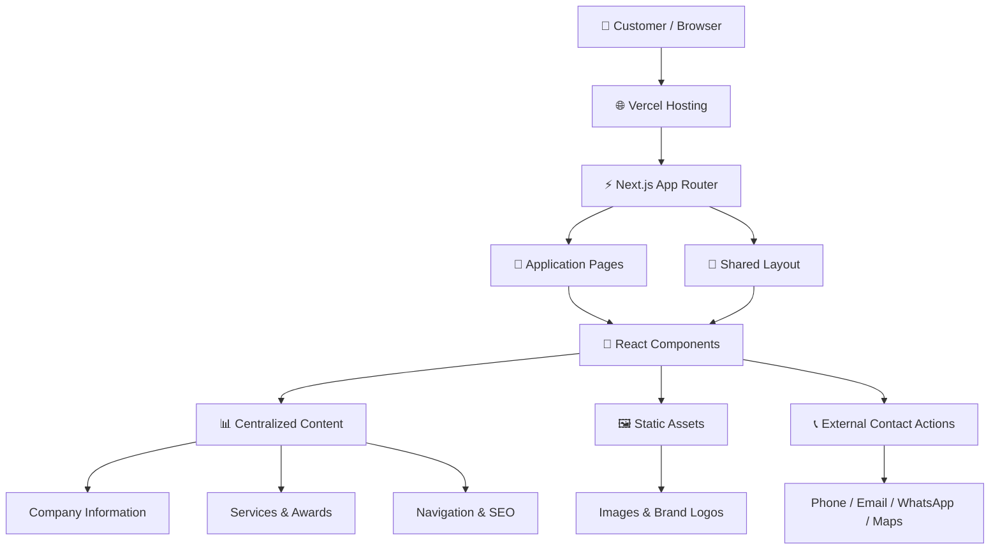
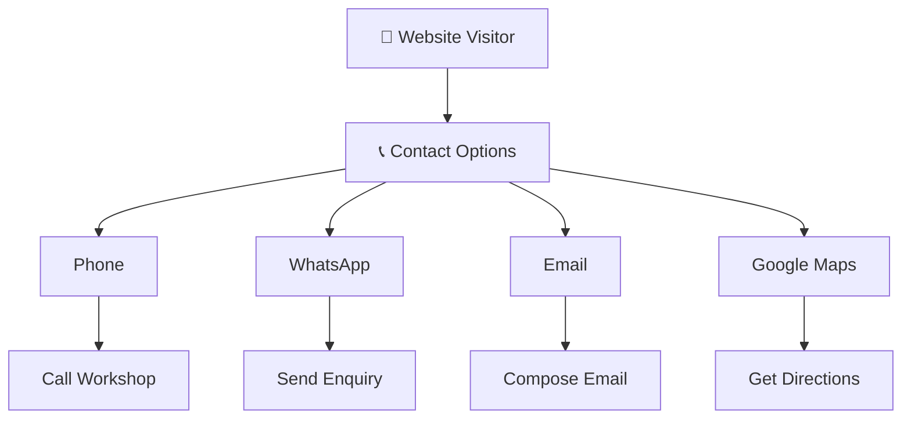
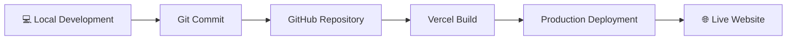

<div align="center">

# 🚛 NEW INDIA AUTOMOTIVE

### Commercial Vehicle Accident Repair & Workshop Services

**Keeping Commercial Vehicles Moving Forward.**

[](https://nextjs.org/)
[](https://react.dev/)
[](https://www.typescriptlang.org/)
[](https://tailwindcss.com/)
[](https://vercel.com/)

[🌐 Live Website](https://new-india-automotive.vercel.app/) · [📂 GitHub Repository](https://github.com/altafshaikh7/new-india-automotive) · [📞 Contact](https://new-india-automotive.vercel.app/contact)

</div>

---

## 📖 About The Project

**New India Automotive** is a professional business website developed for a commercial vehicle accident repair and workshop service company based in Bhiwandi, Maharashtra, India.

Established in **2017**, the company focuses on commercial vehicle accident repair, truck body restoration, chassis repair, denting, painting, mechanical work, electrical repairs, and towing assistance.

The website provides customers with information about the company, its services, vehicle brands, workshop photographs, awards, and contact details.

The project is built using **Next.js, React, TypeScript, and Tailwind CSS**, following a component-based architecture with centralized content management.

<div align="center">

| 🏢 Business | 📍 Location | 📅 Established |
|:---:|:---:|:---:|
| New India Automotive | Bhiwandi, Maharashtra | 2017 |

</div>

## 🌐 Live Website

<div align="center">

### [https://new-india-automotive.vercel.app/](https://new-india-automotive.vercel.app/)

</div>

---

## 📑 Table of Contents

- [📖 About The Project](#-about-the-project)
- [🎯 Project Objectives](#-project-objectives)
- [✨ Website Features](#-website-features)
- [🛠️ Technology Stack](#️-technology-stack)
- [🏗️ System Architecture](#️-system-architecture)
- [📂 Project Structure](#-project-structure)
- [🧭 Application Routes](#-application-routes)
- [🧩 Component Architecture](#-component-architecture)
- [📊 Content Management Architecture](#-content-management-architecture)
- [🖼️ Assets Management](#️-assets-management)
- [🔍 SEO Architecture](#-seo-architecture)
- [📞 Customer Communication Flow](#-customer-communication-flow)
- [⚙️ Installation & Setup](#️-installation--setup)
- [📜 Available Commands](#-available-commands)
- [🌍 Environment Configuration](#-environment-configuration)
- [🚀 Deployment](#-deployment)
- [♿ Accessibility & Responsiveness](#-accessibility--responsiveness)
- [⚠️ Current Implementation Status](#️-current-implementation-status)
- [🛣️ Future Roadmap](#️-future-roadmap)
- [🤝 Contributing](#-contributing)
- [📄 License](#-license)

---

## 🎯 Project Objectives

The primary objectives of this project are:

- Establish a professional online presence for New India Automotive.
- Present commercial vehicle repair services in a structured way.
- Provide detailed information about the company and its workshop.
- Showcase supported vehicle brands and company recognitions.
- Display workshop photographs and service-related images.
- Make phone, email, WhatsApp, and location information easily accessible.
- Improve search engine visibility through technical SEO.
- Deliver a responsive experience across desktop, tablet, and mobile devices.

---

## ✨ Website Features

### 🏠 1. Homepage

The homepage introduces the company and provides access to its main services and information.

**Sections include:**

- Hero section
- Company introduction
- Services overview
- Vehicle brand showcase
- Company statistics
- Why Choose Us
- Insurance information
- Workshop gallery preview
- FAQ preview
- Testimonials section
- Contact call-to-action

### 🏢 2. About Us

Provides information about the company's background and workshop operations.

**Includes:**

- Company introduction
- Who We Are section
- Company highlights
- Company directors
- Awards and recognition
- Business values
- Workshop information

### 🔧 3. Services

A dedicated services section presenting commercial vehicle repair solutions.

| Service | Description |
|---|---|
| Accident Repair | Commercial vehicle accident damage restoration |
| Chassis Repair | Chassis repair and structural restoration |
| Denting | Vehicle body dent removal |
| Painting | Commercial vehicle painting and finishing |
| Mechanical Repair | Mechanical inspection and repair |
| Electrical Work | Vehicle electrical diagnosis and repair |
| Truck Body Repair | Truck body repair and restoration |
| Towing Service | Vehicle recovery and towing assistance |

Each service has a dedicated dynamic detail route.

### 🚛 4. Vehicle Brands

Displays vehicle brands listed in the company information:

- Ashok Leyland
- Eicher
- Tata
- Mahindra

Brand logo assets are maintained locally in the project.

### 🏆 5. Awards & Recognition

Displays company awards and recognition:

- Eicher — Second Runner Up, Overall Parts Business Performance (2025–26).
- Eicher — Star Performer (2023–24).

Award information and image paths are maintained in `src/content/awards.ts`.

### 🖼️ 6. Workshop Gallery

Displays workshop photographs to help visitors understand the company's workshop environment.

### 📞 7. Contact Us

Provides direct communication options:

- Primary phone number
- Alternate phone number
- Email
- WhatsApp
- Workshop address
- Google Maps directions

### 📅 8. Appointment Request

Allows visitors to contact the workshop through phone or WhatsApp to discuss an appointment.

**Note:** Online appointment booking and automatic appointment confirmation are not currently implemented.

### 🛡️ 9. Insurance / Workshop Enquiry

Provides information for customers who want to discuss vehicle repair requirements and related enquiries.

This is an enquiry page, not an online insurance claim management system.

### ❓ 10. Frequently Asked Questions

A dedicated FAQ route is available. The currently rendered page directs visitors to contact the company because a published FAQ list is not yet implemented there.

---

## 🛠️ Technology Stack

The project uses the following technologies and tools:

| Technology | Purpose |
|---|---|
| Next.js 16.4.5 | React framework and application routing |
| React 19 | Component-based UI development |
| TypeScript 5 | Static typing and maintainable code |
| Tailwind CSS 4 | Responsive styling |
| shadcn/ui | UI component foundation |
| Base UI React | Accessible UI primitives |
| Motion | UI animations |
| Lucide React | Icons |
| next/font | Geist font integration |
| ESLint 9 | Code quality and linting |
| Vercel | Deployment and hosting |
| Git & GitHub | Version control and source management |

**Package versions:** Refer to `package.json` and `package-lock.json` for the exact installed dependency versions.

---

## 🏗️ System Architecture

The application follows a component-based architecture using the Next.js App Router.

### High-Level Architecture



### Application Request Flow

1. A visitor opens a website URL.
2. Next.js App Router identifies the requested route.
3. The corresponding page component is rendered.
4. Shared layout and reusable components are composed.
5. Centralized content modules provide business and page information.
6. Static assets are served from the `public/` directory.
7. Customer contact links open their respective external applications.

### Architectural Principles

- Component-based development.
- Reusable UI components.
- Centralized business content.
- Dynamic service routing.
- Static asset management.
- Page-level SEO metadata.
- Shared application layout.
- Client-side interactions where required.

---

## 📂 Project Structure

The following is the main application architecture and folder organization.

```text
new-india-automotive/
│
├── public/
│   │
│   ├── brands/
│   │   ├── AMW Peak Logo with Red Swoosh.png
│   │   ├── Ashok Leyland Blue Emblem Logo.png
│   │   ├── BharatBenz Chrome Emblem Logo.png
│   │   ├── Eicher Red Horse Logo.png
│   │   ├── Force Motors Blue and Black Logo.png
│   │   ├── Mahindra Red Swoosh Logo.png
│   │   ├── SML Isuzu Logo.png
│   │   └── Tata Motors Blue Logo.png
│   │
│   ├── images/
│   │   │
│   │   ├── awards/
│   │   │   ├── eicher-parts-performance-2025-26.jpeg
│   │   │   ├── eicher-star-performer-2023-24.jpeg
│   │   │   └── mahindra-genuine-spares-retailer.png
│   │   │
│   │   ├── hero/
│   │   │   ├── home-hero.webp
│   │   │   └── slideshow/
│   │   │       ├── multi-brand-truck-lineup.webp
│   │   │       ├── premium-workshop-scene.webp
│   │   │       ├── truck-hero-final.webp
│   │   │       ├── truck-on-highway.webp
│   │   │       ├── truck-workshop-exterior.webp
│   │   │       └── workshop-interior.webp
│   │   │
│   │   ├── services/
│   │   │   ├── accident-repair.webp
│   │   │   ├── chassis-repair.webp
│   │   │   ├── denting.webp
│   │   │   ├── electrical-work.webp
│   │   │   ├── mechanical-repair.webp
│   │   │   ├── painting.webp
│   │   │   ├── services-hero.webp
│   │   │   ├── towing-service.webp
│   │   │   └── truck-body-repair.webp
│   │   │
│   │   ├── team/
│   │   │   ├── owner-1.png
│   │   │   └── owner-2.png
│   │   │
│   │   └── workshop/
│   │       ├── workshop-about.webp
│   │       └── workshop.webp
│   │
│   ├── company-logo.png
│   └── google-site-verification.html
│
├── src/
│   │
│   ├── app/
│   │   │
│   │   ├── about/
│   │   │   └── page.tsx
│   │   │
│   │   ├── book-appointment/
│   │   │   └── page.tsx
│   │   │
│   │   ├── brands/
│   │   │   └── page.tsx
│   │   │
│   │   ├── contact/
│   │   │   └── page.tsx
│   │   │
│   │   ├── faq/
│   │   │   └── page.tsx
│   │   │
│   │   ├── gallery/
│   │   │   └── page.tsx
│   │   │
│   │   ├── insurance/
│   │   │   └── page.tsx
│   │   │
│   │   ├── services/
│   │   │   ├── [slug]/
│   │   │   │   └── page.tsx
│   │   │   └── page.tsx
│   │   │
│   │   ├── globals.css
│   │   ├── layout.tsx
│   │   ├── not-found.tsx
│   │   ├── page.tsx
│   │   ├── robots.ts
│   │   └── sitemap.ts
│   │
│   ├── components/
│   │   │
│   │   ├── awards/
│   │   │   └── awards-section.tsx
│   │   │
│   │   ├── contact/
│   │   │   ├── contact-info.tsx
│   │   │   └── google-map.tsx
│   │   │
│   │   ├── forms/
│   │   │   ├── appointment-form.tsx
│   │   │   ├── contact-form.tsx
│   │   │   └── form-demo-notice.tsx
│   │   │
│   │   ├── gallery/
│   │   │   ├── gallery-grid.tsx
│   │   │   └── gallery-lightbox.tsx
│   │   │
│   │   ├── home/
│   │   │   ├── hero-section.tsx
│   │   │   ├── intro-section.tsx
│   │   │   ├── services-overview.tsx
│   │   │   ├── brands-section.tsx
│   │   │   ├── home-statistics.tsx
│   │   │   ├── why-choose-us.tsx
│   │   │   ├── insurance-overview.tsx
│   │   │   ├── gallery-preview.tsx
│   │   │   ├── faq-preview.tsx
│   │   │   ├── testimonials-section.tsx
│   │   │   └── cta-section.tsx
│   │   │
│   │   ├── layout/
│   │   │   ├── navbar.tsx
│   │   │   ├── mobile-nav.tsx
│   │   │   ├── header.tsx
│   │   │   ├── footer.tsx
│   │   │   ├── company-logo.tsx
│   │   │   ├── theme-provider.tsx
│   │   │   └── theme-toggle.tsx
│   │   │
│   │   ├── services/
│   │   │   ├── service-card.tsx
│   │   │   └── service-detail.tsx
│   │   │
│   │   ├── shared/
│   │   │   ├── animated-section.tsx
│   │   │   ├── call-button.tsx
│   │   │   ├── container.tsx
│   │   │   ├── floating-actions.tsx
│   │   │   ├── page-hero.tsx
│   │   │   ├── section-heading.tsx
│   │   │   └── whatsapp-button.tsx
│   │   │
│   │   └── ui/
│   │       ├── accordion.tsx
│   │       ├── badge.tsx
│   │       ├── brand-marquee.tsx
│   │       ├── button.tsx
│   │       ├── card.tsx
│   │       ├── dialog.tsx
│   │       ├── input.tsx
│   │       ├── label.tsx
│   │       ├── scroll-reveal.tsx
│   │       ├── select.tsx
│   │       ├── sheet.tsx
│   │       └── textarea.tsx
│   │
│   ├── content/
│   │   ├── awards.ts
│   │   ├── brands.ts
│   │   ├── company.ts
│   │   ├── faqs.ts
│   │   ├── gallery.ts
│   │   ├── insurance.ts
│   │   ├── navigation.ts
│   │   ├── seo.ts
│   │   ├── services.ts
│   │   ├── testimonials.ts
│   │   └── why-choose-us.ts
│   │
│   ├── hooks/
│   │   └── use-scroll-position.ts
│   │
│   ├── lib/
│   │   ├── metadata.ts
│   │   ├── utils.ts
│   │   ├── validations.ts
│   │   └── whatsapp.ts
│   │
│   └── types/
│       └── index.ts
│
├── components.json
├── eslint.config.mjs
├── next.config.ts
├── package.json
├── package-lock.json
├── tsconfig.json
├── .gitignore
├── AGENTS.md
└── README.md
```

> **Note:** The structure is an architectural reference. Individual component files may evolve as the application is updated.

### 📁 Important Directories

| Directory | Responsibility |
|---|---|
| `src/app/` | Application routes and page rendering |
| `src/components/` | Reusable React components |
| `src/content/` | Centralized business and website content |
| `src/hooks/` | Reusable React hooks |
| `src/lib/` | Utility functions and helper logic |
| `src/types/` | Shared TypeScript types |
| `public/` | Static images, logos and other assets |

---

## 🧭 Application Routes

The website uses the Next.js App Router.

| Route | Page | Description |
|---|---|---|
| `/` | Home | Main landing page |
| `/about` | About Us | Company introduction and awards |
| `/services` | Services | Complete services overview |
| `/services/accident-repair` | Accident Repair | Individual service details |
| `/services/chassis-repair` | Chassis Repair | Individual service details |
| `/services/denting` | Denting | Individual service details |
| `/services/painting` | Painting | Individual service details |
| `/services/mechanical-repair` | Mechanical Repair | Individual service details |
| `/services/electrical-work` | Electrical Work | Individual service details |
| `/services/truck-body-repair` | Truck Body Repair | Individual service details |
| `/services/towing-service` | Towing Service | Individual service details |
| `/brands` | Brands | Vehicle brands |
| `/gallery` | Gallery | Workshop images |
| `/contact` | Contact | Contact information |
| `/book-appointment` | Appointment | Appointment request instructions |
| `/insurance` | Insurance | Workshop enquiry |
| `/faq` | FAQ | Frequently asked questions |

### Dynamic Routing

The route:

```text
/services/[slug]
```

is used to render individual service pages dynamically.

Service information is retrieved from:

```text
src/content/services.ts
```

The implementation uses `generateStaticParams()` to generate service route parameters and `generateMetadata()` to provide service-specific metadata.

---

## 🧩 Component Architecture

The project separates application functionality into reusable components.

### 🧭 Layout Components

Location: `src/components/layout/`

| Component | Responsibility |
|---|---|
| Navbar | Main desktop navigation |
| MobileNav | Mobile navigation |
| Header | Reusable header |
| Footer | Shared footer |
| CompanyLogo | Company logo |
| ThemeProvider | Theme management |
| ThemeToggle | Appearance control |

### 🏠 Homepage Components

Location: `src/components/home/`

Homepage sections are maintained independently to make UI updates easier.

Examples:

- HeroSection
- IntroSection
- ServicesOverview
- BrandsSection
- HomeStatistics
- WhyChooseUs
- InsuranceOverview
- GalleryPreview
- FAQPreview
- TestimonialsSection
- CTASection

### 🔧 Service Components

Location: `src/components/services/`

- ServiceCard
- ServiceDetail

### 🖼️ Gallery Components

Location: `src/components/gallery/`

- GalleryGrid
- GalleryLightbox

### 🏆 Awards Components

Location: `src/components/awards/`

- AwardsSection

### ♻️ Shared Components

Location: `src/components/shared/`

Reusable elements for common interface functionality:

- AnimatedSection
- CallButton
- Container
- FloatingActions
- PageHero
- SectionHeading
- WhatsAppButton

### 🎨 UI Components

Location: `src/components/ui/`

Reusable UI primitives such as buttons, cards, dialogs, accordions, inputs, selects, sheets, textareas, and scroll-reveal components.

---

## 📊 Content Management Architecture

The project uses centralized TypeScript files to manage business information and website content.

| File | Responsibility |
|---|---|
| `company.ts` | Company name, address, phone, email and business information |
| `navigation.ts` | Navigation links and menu configuration |
| `services.ts` | Service names, descriptions, image paths and slugs |
| `awards.ts` | Awards, issuers, recipients and image dimensions |
| `seo.ts` | Website URL, SEO title, descriptions and keywords |
| `brands.ts` | Brand-related content |
| `faqs.ts` | FAQ content |
| `gallery.ts` | Gallery content |
| `insurance.ts` | Insurance-related content |
| `testimonials.ts` | Testimonial content |
| `why-choose-us.ts` | Company highlights |

### Example: Company Configuration

`src/content/company.ts`

```ts
export const company = {
  name: "New India Automotive",
  established: 2017,

  address: {
    line1: "Bhatale, Vehele",
    city: "Bhiwandi",
    state: "Maharashtra",
    pincode: "421302",
    country: "India",
  },

  phone: {
    primary: "8237263878",
    alternate: "8149949328",
  },

  email: "newindiaautomotivebuisness@gmail.com",
};
```

Centralized configuration helps maintain consistent business information throughout the website.

---

## 🖼️ Assets Management

All static assets are stored inside the `public/` directory.

| Folder | Purpose |
|---|---|
| `public/brands/` | Manufacturer logos |
| `public/images/awards/` | Award photographs |
| `public/images/hero/` | Homepage hero images |
| `public/images/hero/slideshow/` | Hero slideshow assets |
| `public/images/services/` | Service images |
| `public/images/team/` | Team/director photographs |
| `public/images/workshop/` | Workshop photographs |

### Example Asset Usage

```tsx
import Image from "next/image";

<Image
  src="/images/services/accident-repair.webp"
  alt="Commercial vehicle accident repair"
  width={1200}
  height={800}
/>
```

**Image guidelines:**

- Use descriptive filenames.
- Prefer optimized WebP images where suitable.
- Maintain original image proportions.
- Use meaningful alternative text.
- Avoid unnecessarily large image files.

---

## 🔍 SEO Architecture

The website uses Next.js Metadata APIs for search engine optimization.

### Global SEO

Implemented in:

```text
src/app/layout.tsx
```

Includes:

- Default page title
- Title template
- Meta description
- Keywords
- Open Graph metadata
- Website icon
- Robots indexing directives
- Metadata base URL

### Central SEO Configuration

```text
src/content/seo.ts
```

Stores:

- Website name
- Canonical website URL
- Default SEO title
- Default description
- Keyword configuration
- Homepage SEO content

### Dynamic SEO

Service detail pages generate page-specific metadata based on the service slug.

### Sitemap

```text
src/app/sitemap.ts
```

Generates sitemap entries for static website routes and service detail routes.

### Robots

```text
src/app/robots.ts
```

Defines crawler access rules and references the sitemap.

---

## 📞 Customer Communication Flow

The current website provides direct customer communication options.



### Communication Methods

| Method | Implementation |
|---|---|
| Phone | `tel:` links |
| WhatsApp | WhatsApp Business URL |
| Email | `mailto:` links |
| Location | Google Maps search URL |

Contact information is sourced from:

```text
src/content/company.ts
```

### Appointment Request Flow

Visitors can call or WhatsApp the workshop to discuss vehicle repair requirements and request a suitable appointment time.

**Current status:** No automatic appointment creation, online booking database, or appointment confirmation system is connected.

---

## ⚙️ Installation & Setup

Follow these steps to run the project locally.

### Prerequisites

Make sure the following tools are installed:

- Node.js
- npm
- Git
- Code editor (VS Code recommended)

### 1. Clone Repository

```bash
git clone https://github.com/altafshaikh7/new-india-automotive.git
```

### 2. Navigate to Project

```bash
cd new-india-automotive
```

### 3. Install Dependencies

```bash
npm install
```

### 4. Start Development Server

```bash
npm run dev
```

### 5. Open in Browser

```text
http://localhost:3000
```

The application will run locally with Next.js development mode and hot reload.

---

## 📜 Available Commands

| Command | Description |
|---|---|
| `npm run dev` | Start development server |
| `npm run build` | Create production build |
| `npm run start` | Start production server |
| `npm run lint` | Run ESLint |

### Production Build

```bash
npm run build
```

### Production Server

```bash
npm run start
```

### Code Quality Check

```bash
npm run lint
```

---

## 🌍 Environment Configuration

The currently documented frontend functionality does not require application-specific environment variables.

If future integrations introduce external services, database credentials, email services, or API keys, configure them using environment variables.

Example:

```env
# Example only — configure when an integration is implemented

DATABASE_URL=
NEXT_PUBLIC_SITE_URL=
EMAIL_API_KEY=
```

**Security:** Never commit actual API keys, database credentials, passwords, or secrets to GitHub.

---

## 🚀 Deployment

The website is hosted on **Vercel**.

### Live Deployment

[https://new-india-automotive.vercel.app/](https://new-india-automotive.vercel.app/)

### Deployment Workflow



### Deployment Steps

1. Make changes in the local project.
2. Test the application.
3. Commit changes to Git.
4. Push changes to the connected GitHub repository.
5. Vercel builds and deploys the application according to its project configuration.

### Git Commands

```bash
git add .
git commit -m "Update website"
git push origin main
```

---

## ♿ Accessibility & Responsiveness

The application uses responsive Tailwind CSS layouts and reusable UI components.

Development considerations include:

- Semantic HTML structure.
- Meaningful image alternative text.
- Accessible navigation labels.
- Visible keyboard focus styles.
- Responsive page layouts.
- Reduced-motion support in selected animated components.

Future UI changes should preserve keyboard accessibility and respect user motion preferences.

---

## ⚠️ Current Implementation Status

The following table distinguishes existing frontend functionality from features that are not yet connected to backend systems.

| Feature | Current Status |
|---|---|
| Homepage | Implemented |
| About Us | Implemented |
| Services Overview | Implemented |
| Dynamic Service Pages | Implemented |
| Vehicle Brands | Implemented |
| Workshop Gallery | Implemented |
| Awards Section | Implemented |
| Contact Information | Implemented |
| Phone & WhatsApp Links | Implemented |
| Google Maps Directions | Implemented |
| SEO Metadata | Implemented |
| Sitemap | Implemented |
| Robots Configuration | Implemented |
| Online Appointment Booking | Not Implemented |
| Appointment Database | Not Implemented |
| Contact Form Backend | Not Implemented |
| Admin Dashboard | Not Implemented |
| Customer Authentication | Not Implemented |
| Insurance Claim Tracking | Not Implemented |

**Technical note:** Form-related component files exist in the repository, but their presence alone does not mean a production form submission backend is connected.

---

## 🛣️ Future Roadmap

Potential improvements for future development:

### Phase 1 — Website Improvements

- Expand workshop gallery.
- Add more verified company information.
- Publish frequently asked questions.
- Continue accessibility and performance improvements.

### Phase 2 — Backend Integration

- Build appointment request API.
- Add contact enquiry processing.
- Introduce email notifications.
- Add server-side validation and spam protection.

### Phase 3 — Administration

- Admin dashboard.
- Manage service information.
- Manage gallery photographs.
- Manage awards and company content.
- Review customer enquiries.

### Phase 4 — Business Management

- Persistent appointment records.
- Customer enquiry management.
- Service request tracking.
- Reporting and analytics.

These are proposed enhancements, not existing application features.

---

## 🤝 Contributing

Contributions and suggestions are welcome.

### Contribution Workflow

1. Fork the repository.
2. Create a new feature branch.
3. Make your changes.
4. Run lint and build checks.
5. Commit your changes.
6. Open a Pull Request.

### Create a Feature Branch

```bash
git checkout -b feature/your-feature-name
```

### Validate Changes

```bash
npm run lint
npm run build
```

### Commit Changes

```bash
git add .
git commit -m "Add your feature description"
git push origin feature/your-feature-name
```

---

## 📄 License

No explicit open-source license is currently declared in this repository.

Unless a license is added, the project should not be assumed to be available for unrestricted reuse, redistribution, or modification.

---

## 📬 Contact & Project Links

<div align="center">

### NEW INDIA AUTOMOTIVE

**Commercial Vehicle Accident Repair**

📍 Bhatale, Vehele, Bhiwandi, Maharashtra – 421302, India

📞 **8237263878**

📧 **newindiaautomotivebuisness@gmail.com**

🌐 [Visit Website](https://new-india-automotive.vercel.app/)

💻 [GitHub Repository](https://github.com/altafshaikh7/new-india-automotive)

---

**Built with ❤️ using Next.js, React, TypeScript & Tailwind CSS.**

</div>
